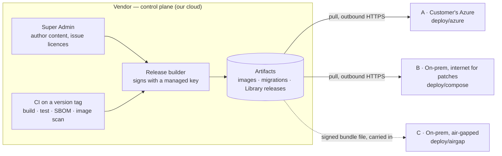

# Deployment architecture

> **Status: design + skeleton.** This folder shows *how* NiyamSaathi will be packaged and run for customers. The files are
> structure and intent, not yet deployable. Each section says what exists today (✅) and what is still to build (🔲).
> Build order and effort: [docs/architecture/03-implementation-plan.md](../docs/architecture/03-implementation-plan.md).
> Design decisions behind this: [docs/architecture/README.md](../docs/architecture/README.md) (D1–D22).

## The idea in one paragraph

**One codebase, one set of container images.** Every customer runs their **own, dedicated** deployment — there is no shared
multi-customer cloud, and the customer (not us) operates it. We never connect *into* a customer's network. The vendor side
builds, signs and publishes releases; a customer's deployment either **pulls** them over outbound HTTPS or, if it has no
internet, imports a **signed bundle file** that someone carries in. What differs between customers is only *configuration,
adapters and packaging* — never branches in the application code.



## The three variants

| | **A · Customer's Azure** | **B · On-prem, internet for patches** | **C · On-prem, air-gapped** |
|---|---|---|---|
| Runs on | Azure Container Apps | A Linux VM with Docker or Podman (Compose) | Same as B |
| Database | Azure PostgreSQL Flexible Server | PostgreSQL in the stack, or the customer's own | Same as B |
| Files (evidence) | Azure Blob Storage | Disk or NAS volume; S3-compatible optional | Same as B |
| Queue | Azure Managed Redis (to be verified) or a Valkey container | Valkey container | Same as B |
| Secrets | Azure Key Vault + managed identity | Docker secrets / files, customer's vault | Same as B |
| Sign-in | Microsoft Entra | OIDC (AD FS, Keycloak, Okta) / LDAP / local | Same as B (IdP is inside the site) |
| Updates arrive by | Pull (pipeline or `dpdpctl`) | Pull (`dpdpctl update`) | Signed **bundle file** (`dpdpctl bundle apply`) |
| Installed with | Bicep (`what-if`, then deploy) | `dpdpctl install` | `dpdpctl install` from a first-install bundle |
| Operated by | Customer | Customer (we assist at first) | Customer |
| Folder | [azure/](azure/) | [compose/](compose/) | [airgap/](airgap/) |

## What is identical everywhere, and what is not

| Identical in all variants | Differs per variant (configuration / adapter / packaging) |
|---|---|
| The container images (API + worker), by digest | Where the database, queue and files live |
| Database migrations and the migration runner | How secrets are supplied |
| The signed licence and the read-only gate | TLS certificates and DNS |
| The Library importer (same code reads a URL or a file) | The identity provider |
| Health (`/health`), readiness (`/ready`), version (`/version`), graceful shutdown | How an update is delivered and applied |

## Folder map

```
deploy/
  README.md            ← you are here
  docker/              the image set and build rules (shared by all variants)
  azure/               Variant A — Bicep (Azure Verified Modules), sizes, runbook
  compose/             Variant B — Docker Compose stack, proxy, secrets, overrides
  airgap/              Variant C — bundle format, how bundles are built/verified/applied, no-egress test lane
tools/
  dpdpctl/             the operator CLI used by B and C (and, for migrations, by A)
```

## `dpdpctl` — one tool for the people who run it

| Command | What it does |
|---|---|
| `install` | First install: checks the host, writes config, starts the stack, runs migrations, activates with the licence |
| `plan` | Says what an update would do and which "required stops" lie in between (nothing is changed) |
| `update` | Pull → verify signature → back up → migrate → switch → health check → record |
| `bundle verify \| plan \| apply` | The same, from a signed file (air-gapped) |
| `backup`, `backup verify`, `restore` | Database + files + (separately) the encryption keys; `verify` restores into a scratch database and checks it |
| `doctor` | Checks DNS, time (NTP), disk, ports, database, Redis `noeviction`, storage, licence, version skew |
| `support-bundle` | Collects logs and settings (secrets removed) for support, without internet |

## What exists today, and what does not

| Building block | Status |
|---|---|
| `/health`, `/ready` (database, migrations, queue, storage), `/version`, graceful shutdown on SIGTERM | ✅ |
| Start-up configuration validation + documented settings ([`apps/tenant-api/.env.example`](../apps/tenant-api/.env.example)) | ✅ |
| Storage adapter (Azure Blob, local disk), authenticated file links | ✅ |
| Signed licence, activation, read-only mode ([`packages/platform`](../packages/platform)) | ✅ |
| CI that replays every database migration from empty and checks for drift | ✅ |
| Container images and the CI that builds them on a tag | 🔲 step 4 |
| `dpdpctl` and the migration runner (backup gate, lock, drift check) | 🔲 step 4 |
| Signed releases and signed update metadata | 🔲 step 4 |
| Secrets from files (`*_FILE`) and Key Vault references | 🔲 steps 4–5 |
| Azure Bicep package, managed-identity storage access, Managed Redis test | 🔲 step 5 |
| Compose stack, S3-compatible storage adapter, installer | 🔲 step 6 |
| Offline bundles, bundled fonts and media, no-internet CI lane | 🔲 step 7 |

## Rules that hold for every variant

1. **Instances only pull (or import a file).** Nothing of ours ever connects in.
2. **Never `if (variant)` in application code.** A difference is a setting or an adapter.
3. **Updates are forward-only and reversible by image**: schema changes are additive (expand → migrate → contract at a
   required stop), so the previous image keeps working until a destructive step is deliberately reached.
4. **Back up before every migration** (the backup gate), and keep the encryption keys backed up **separately**.
5. **Customer data is never locked away**: an expired licence makes the portal read-only; viewing and export always work.
6. **Everything signed is verified offline**: releases, update metadata, bundles and licences.
