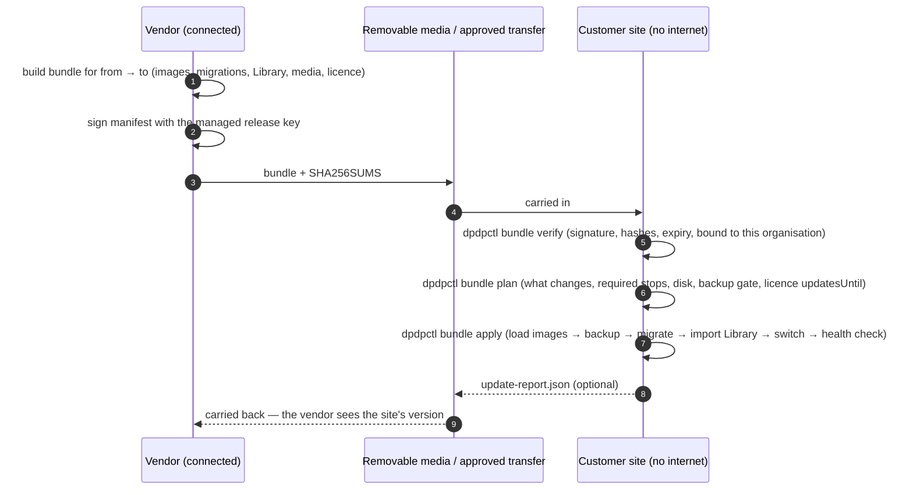

# Variant C — On-prem, air-gapped

> Status: 🔲 **step 7** — design. Nothing here is built yet.
> This variant runs the **same stack as Variant B** ([../compose/](../compose/)). The only thing that changes is **how updates and
> content arrive**: as a **signed file that a person carries in**, never over a network.
> Shared rules: [../README.md](../README.md). File format: [bundle-format.md](bundle-format.md).

Typical customers: defence-adjacent, government, banking back-offices and critical infrastructure that forbid any outbound
connection. They still need the software kept patched and the regulation content kept current.

## The idea

The vendor builds a **bundle** — one signed archive that contains everything needed to move a deployment from version *X* to
version *Y*: container images, database migrations, the regulation/control content ("Library"), media, and a refreshed licence.
It is carried across the air gap on removable media (or an approved transfer). On the customer's side `dpdpctl` **verifies it
completely offline** — signature, per-file hashes, expiry, that it belongs to this organisation — shows a plan, and only then
applies it. A small `update-report.json` can be carried back so we know what version each site is on.



## Two kinds of bundle

| | **Install bundle** | **Update bundle** |
|---|---|---|
| Purpose | First installation of a site | Move an installed site from *X* to *Y* |
| Contains | `dpdpctl`, all images (including PostgreSQL, Valkey, proxy), schema baseline, full Library, media packs, licence | Changed images only, new migrations, Library **delta**, media **delta by hash**, refreshed licence |
| Size | Large (images + media) | Small to large, depending on media |
| Cumulative | — | Yes, inside the support window (one bundle can span several versions) |

Content that does not need a new application version (a corrected control, a new regulation) travels as a **Library release**
inside an update bundle, or alone — the importer is the same code that reads a release from a URL in the connected variants.

## What protects the site

| Threat | Protection |
|---|---|
| Tampered or corrupted bundle | Signature over the manifest + SHA-256 of every file, checked **before** anything is touched |
| A bundle meant for another customer | Bound to the organisation (and optionally the instance) named in the licence; refused otherwise |
| Replay / rollback / "freeze" (old bundle presented as new) | Manifest has a sequence number, `notBefore` and an **expiry**; the site records the highest applied sequence and refuses older or expired bundles |
| Update that cannot be undone | Backup gate before migration; schema changes are additive, so the previous image keeps working until a deliberate "required stop" |
| Signing key compromise or rotation | Trust list holds key ids; a new key is introduced by a bundle signed with the old one; a revocation list travels in the manifest |
| Licence lapses while offline | **60-day grace** (30 for connected sites), then read-only (view + export always remain); renewal arrives as a file like a bundle |
| Clock wound back | Monotonic "last seen" timestamp: a large backward jump marks the licence state and needs a fresh licence |

## Differences from a connected on-prem site

- **No outbound access at all.** Fonts and any other assets are bundled (no CDN); an automated **no-egress test lane** proves the
  whole product works with no route out → [no-egress-ci/](no-egress-ci/).
- **Media** (LMS videos, certificate images, sample evidence) is shipped as content-addressed, chunked, resumable **asset packs**
  by hash delta, so only new media is carried. A course is published only when every asset it needs is present.
  Embedded YouTube/Vimeo lessons cannot play offline and are flagged when the bundle is built.
- **Time** comes from an internal NTP source (the licence and tokens depend on sane time).
- **Identity** is the site's own (AD FS, Keycloak, LDAP, or local accounts); **mail** is an internal relay or "copy link".
- **Backups** are the customer's; restore tooling and runbook are the same as Variant B.

## Customer's responsibilities

Carry bundles in on the agreed schedule (security fixes are the urgent ones) · keep the server clock correct · run backups and
keep the encryption keys backed up separately · renew the licence file before grace runs out · optionally return
`update-report.json`.

## Open items (for step 7)

- Bundle size strategy for media (resumable copy, split volumes).
- Whether install bundles are produced per customer or generic + licence delivered separately (leaning: generic + licence file).
- Format version policy and how long old formats stay readable.
- Mirroring third-party images (PostgreSQL, Valkey, proxy) and keeping their security patches current in bundles.

## Files

```
airgap/
  README.md                this page
  bundle-format.md         the archive layout, the manifest, and exactly how a bundle is verified
  manifest.example.json    an example manifest (illustrative values)
  no-egress-ci/README.md   the CI lane that proves the product works with no network access
```
