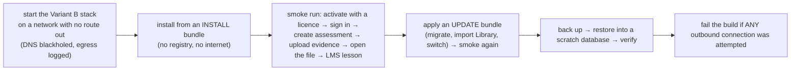

# No-egress CI lane

> Status: 🔲 design for step 7.

**Why:** "works offline" is easy to break by accident — a font loaded from a CDN, a library that phones home, a health check to an
external address. For an air-gapped customer that is an outage. So CI proves, on every release, that the product runs with **no route
out**.

## What the lane does

## Checks

- **No outbound connections**: the stack's network has no gateway; every attempt (TCP, DNS) is recorded and fails the run.
- **No external hosts in the built web app**: a scan of the built assets for `http(s)://` hosts other than the portal itself
  (this is what catches CDN fonts and scripts).
- **Bundle verification is truly offline**: `dpdpctl bundle verify` runs with the network disabled; a tampered file, an expired
  manifest, a wrong organisation and an older sequence are each refused (negative tests).
- **Clock tests**: a licence lapsing while offline moves through grace to read-only; winding the clock back is detected.

## Where it runs

On the same CI runner as the other lanes, using Docker networks with `internal: true` and a log of attempted connections (or a
network namespace with packet logging). It is a **separate lane** so a failure points straight at an offline-breaking change.
