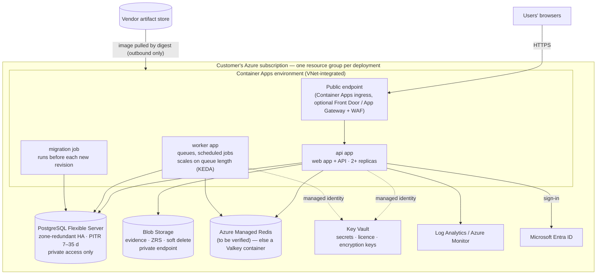

# Variant A — Customer's Azure subscription

> Status: 🔲 **step 5** — skeleton. The Bicep files show the intended structure; they are not deployable yet.
> Shared rules: [../README.md](../README.md). Images: [../docker/](../docker/).

A **dedicated** deployment in the **customer's own** Azure subscription, operated by the customer. Roughly 90 % of our cloud
customers will use this variant.

## Architecture



## What is deployed

| Resource | Purpose | Notes |
|---|---|---|
| Container Apps environment | Runs the containers; revisions give zero-downtime deploys and instant rollback | VNet-integrated |
| `api` app | Serves the web app and the API | min 2 replicas in production sizes; ingress HTTPS only |
| `worker` app | Background jobs, scheduled snapshots, cloud scans | scales on queue length |
| `migration` job | Applies database migrations (backup first, lock, drift check) | one execution per release, before the new revision takes traffic |
| PostgreSQL Flexible Server | The organisation's data (`public`), Library replica (`catalog`), platform state (`platform_*`) | zone-redundant HA, private networking, point-in-time restore |
| Storage account (Blob) | Customer evidence files, versions, learner files | ZRS, soft delete, no public access, **managed identity** (no keys) |
| Azure Managed Redis | BullMQ queue | **To verify**: needs `maxmemory-policy = noeviction` and a cluster policy BullMQ accepts. Fallback: Valkey container app |
| Key Vault | Secrets, the licence, encryption keys | referenced by the apps through managed identity |
| User-assigned managed identity | Pull images, read Key Vault, write Blob | no passwords or connection strings in settings |
| Log Analytics workspace | Logs, metrics, alerts | retention set per customer |

## How it is deployed and updated

1. **Deploy:** `az deployment group what-if` (always reviewed) → `az deployment group create` with a parameter file. Bicep +
   **Azure Verified Modules**, so the customer's cloud team can read and adopt it.
2. **Activate:** the licence is supplied as a Key Vault secret (`LICENCE_TOKEN`) or pasted on the first-run page; the
   deployment creates the organisation and invites its CEO.
3. **Update:** a new image digest → the **migration job** runs → a **new revision** starts → health (`/ready`) is checked →
   traffic shifts. Roll back by re-activating the previous revision (the schema stays compatible — see rule 3 in the overview).
   Updates are pulled by the customer's pipeline or `dpdpctl update`; we never push.

## Sizes

Reference sizes are set from a load test and monitoring, then adjusted (decision D20). The values in
[`bicep/main.bicep`](bicep/main.bicep) are **placeholders**.

| | Small | Medium | Large |
|---|---|---|---|
| api / worker | 0.5 vCPU · 1 GiB, 1–3 replicas | 1 vCPU · 2 GiB, 2–6 | 2 vCPU · 4 GiB, 3–10 |
| PostgreSQL | General Purpose, 2 vCore | 4 vCore | 8 vCore, larger storage |
| HA | optional | zone-redundant | zone-redundant |

## What the customer provides

An Azure subscription and a resource group (or permission to create one) · a region · a DNS name and TLS certificate for the
portal · a Microsoft Entra app registration (for sign-in) · an outgoing mail service (SMTP or equivalent) · the **licence** we issue.

## Security posture

- No public endpoint for the database, storage or Key Vault (private endpoints); only the portal's ingress is public.
- Managed identity everywhere; **no secrets in app settings** (Key Vault references).
- Encryption keys (for stored cloud credentials and Entra secrets) live in Key Vault and are **backed up separately** from the database.
- Image digests pinned; images scanned and signed; SBOM published.
- Backups and retention are the **customer's** responsibility; we provide the restore tooling and the runbook.

## Open items (for step 5)

- Verify Azure Managed Redis with BullMQ (`noeviction`); otherwise run Valkey as a container app.
- Move storage access to managed identity in the application (the adapter currently uses a connection string).
- Decide private-endpoint defaults vs. a simpler "public with firewall" profile for small customers.
- Exact Azure Verified Module names and versions (pinned when implemented).

## Files

```
azure/
  README.md                this page
  bicep/
    main.bicep             entry point: parameters, sizes, wiring of the modules
    main.example.bicepparam  an example parameter file
    modules/
      identity.bicep       user-assigned managed identity + role assignments
      monitoring.bicep     Log Analytics workspace
      network.bicep        VNet, subnets, private DNS (optional profile)
      keyvault.bicep       Key Vault and secret references
      postgres.bicep       PostgreSQL Flexible Server (HA, PITR, private access)
      storage.bicep        Blob storage account and the evidence container
      redis.bicep          Azure Managed Redis (or the Valkey fallback)
      containerapps.bicep  Container Apps environment, api, worker, migration job
```
