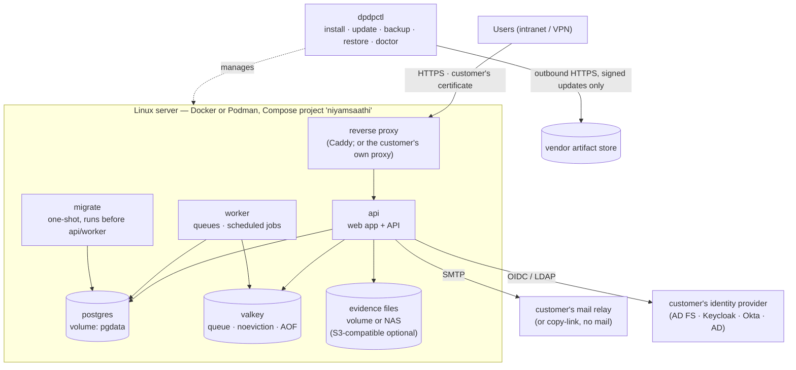

# Variant B — On-prem, internet available for patches

> Status: 🔲 **step 6** — skeleton. [`compose.yaml`](compose.yaml) shows the intended stack; it is not yet runnable because the
> images do not exist (step 4) and `dpdpctl` is not built.
> Variant C (air-gapped) uses **the same stack**; only how updates arrive differs → [../airgap/](../airgap/).
> Shared rules: [../README.md](../README.md).

A **dedicated** deployment on **one Linux server** (or VM) in the customer's data centre, operated by the customer's IT.
Outbound internet is used **only** to fetch signed updates, and can be limited to one address.

## Architecture



## Services

| Service | Image | State | Notes |
|---|---|---|---|
| `proxy` | Caddy (pinned) | certificates | Terminates TLS with **the customer's certificate**; optional — customers may front the stack with their own proxy |
| `api` | `niyamsaathi-api` | none | Stateless; serves the web app and API; `read_only` root filesystem, non-root |
| `worker` | `niyamsaathi-worker` | none | Same release as `api` |
| `migrate` | same image, migrate command | none | Runs once per start/update: backup gate → lock → migrate → drift check |
| `postgres` | PostgreSQL 17 (pinned) | `pgdata` volume | Or the customer's own server: use [`compose.external-db.yaml`](compose.external-db.yaml) |
| `valkey` | Valkey 8 (pinned) | `valkeydata` volume | `maxmemory-policy noeviction`, append-only file |
| evidence files | volume `evidence` | files | Or an S3-compatible store: [`compose.s3-storage.yaml`](compose.s3-storage.yaml) (🔲 adapter in step 6) |

## Install, update, run

1. **Prepare** the server: Linux (RHEL / Ubuntu LTS), Docker Engine or Podman, **NTP**, DNS name, the TLS certificate and key,
   an internal mail relay (optional), the identity provider details (optional), the **licence**.
2. **Install:** `dpdpctl install` — checks the host, writes `.env` and secrets, pulls the images (verifying signatures), starts the
   stack, runs migrations, activates with the licence and prints the CEO invitation link.
3. **Update:** `dpdpctl plan` shows what would happen and any **required stops** on the way; `dpdpctl update` pulls the signed
   release, **backs up**, migrates, switches containers, checks `/ready`, and records the result. Roll back by starting the previous
   image (the schema stays compatible).
4. **Back up:** `dpdpctl backup` (database + files) — and keep the **encryption keys backed up separately**, or stored cloud
   credentials become unreadable after a restore. `dpdpctl backup verify` restores into a scratch database and checks counts.
5. **Diagnose:** `dpdpctl doctor`; `dpdpctl support-bundle` produces a redacted archive for support without needing internet.

## Configuration and secrets

All settings are environment variables, validated at start-up (the full documented list:
[`apps/tenant-api/.env.example`](../../apps/tenant-api/.env.example)). [`.env.example`](.env.example) here is the on-prem subset.
Secrets are supplied as **files** (Docker secrets / mounted files) — 🔲 `*_FILE` support arrives with step 4.

## What the customer provides

A Linux server · Docker or Podman · a DNS name and TLS certificate · NTP · (optional) mail relay and identity provider ·
backup storage and a backup schedule (**the customer owns backups**) · the **licence** we issue.

## Hardening defaults

Non-root containers · read-only root filesystems · no published ports except the proxy · pinned image digests · resource limits.
Two Docker networks: **`data`** is private (no route out, nothing published; only PostgreSQL, Valkey and the app containers are on
it) and **`frontend`** carries the proxy and the app's outbound calls (mail, identity provider, update source). The database and
queue are therefore not reachable from outside the host, and the migration container has no outside access at all.

## Open items (for step 6)

- Podman / rootless compatibility pass.
- S3-compatible adapter and which store to recommend (the previous favourite, MinIO, is archived).
- Reverse-proxy choice (Caddy vs. nginx) and a short guide for customers who bring their own.
- Sizing guidance from the load test.

## Files

```
compose/
  README.md                  this page
  compose.yaml               the base stack
  compose.external-db.yaml   override: use the customer's PostgreSQL instead of the bundled one
  compose.s3-storage.yaml    override: evidence in an S3-compatible store instead of a volume
  .env.example               the on-prem settings (names and comments only, no secrets)
  proxy/Caddyfile            reverse proxy with the customer's certificate
```
