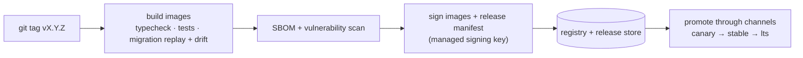

# Container images (shared by every variant)

> Status: 🔲 **step 4** — nothing here is built yet. This page fixes the rules the images must follow.

## The image set — built once, run everywhere

| Image | Contents | Used by |
|---|---|---|
| `niyamsaathi-api` | The tenant API **and** the compiled web app (served by the API) | A, B, C |
| `niyamsaathi-worker` | Same code, worker entry point (queues, scheduled jobs) — may share the API image with a different command | A, B, C |
| `niyamsaathi-scanner` | The Python/Prowler cloud scanner (optional feature) | A, B, C when cloud scanning is used |

Third-party images (PostgreSQL, Valkey, Caddy) are **pinned by digest** and mirrored into the bundle for air-gapped sites.

## Build rules

- **Linux containers only** (decision D13). No Windows service port.
- **Multi-stage, small, non-root** (fixed UID), read-only root filesystem, writable `/tmp` only; no shell tooling in the runtime stage.
- **Reproducible**: pinned base images, lock files, `npm ci`; the image carries the app version and commit (`GET /version`).
- **Health**: `HEALTHCHECK` uses `/health` (alive); orchestrators route traffic on `/ready` (database, migrations finished, queue, storage).
- **Graceful stop**: SIGTERM drains requests (default 25 s) before exit — already implemented in the API and worker.
- **Configuration only from the environment** (validated at start-up; wrong or missing settings stop the process with a list of
  every problem). Secrets from env, **`*_FILE`** (mounted secrets) or Key Vault references 🔲.
- **No network at run time except what the variant configures** (database, queue, storage, mail, identity provider). In
  particular: no CDN fonts or scripts (bundled for air-gap, 🔲 step 7).
- **Supply chain**: SBOM generated and image vulnerability scan on every tagged build; images and release metadata are signed.

## Build and release (CI on a version tag)

Releases carry flags — `required` (a stop that cannot be skipped), `deprecated`, `recalled` — which instances see only through
**signed update metadata with a version and an expiry** (so an old or replayed file is refused).

## Registry

To decide in step 4: GitHub Container Registry or Azure Container Registry. Air-gapped sites never use it — they receive the
same images inside a bundle ([`../airgap/`](../airgap/)).
