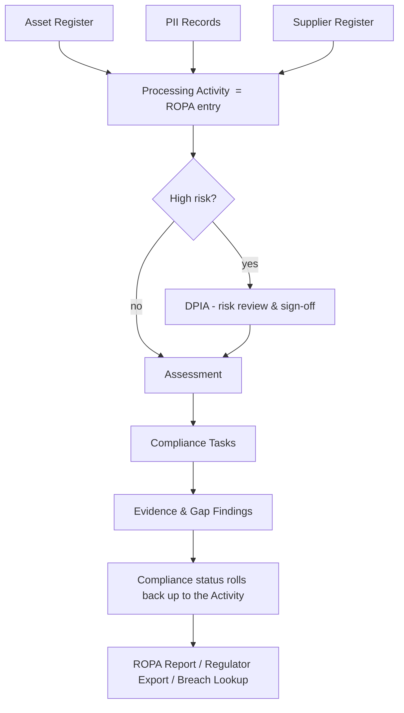
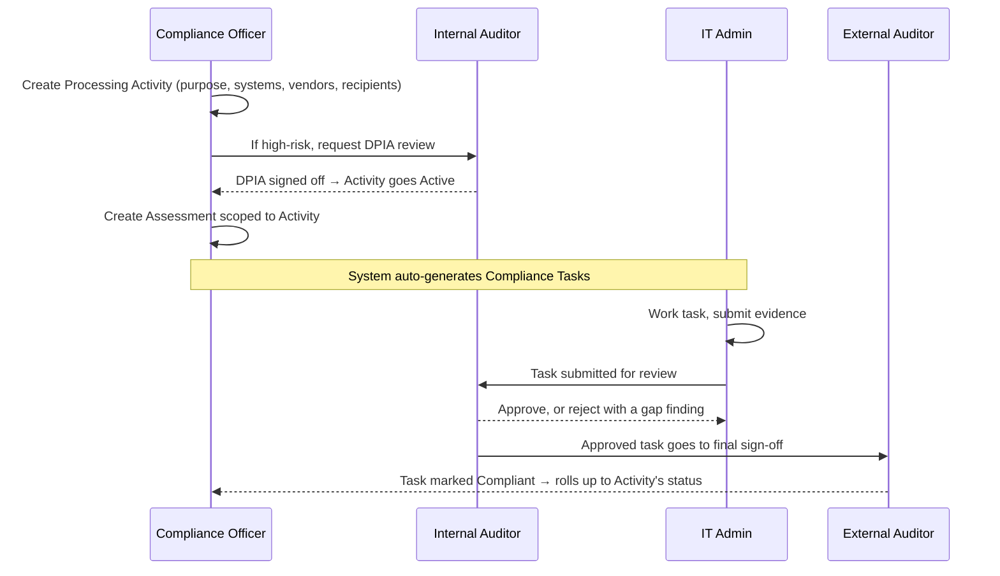

# ROPA (Record of Processing Activities) — Workflow & Platform Mapping

**Purpose of this document:** explain what a ROPA is, and how it would work inside our DPDP compliance platform — the workflow, the roles involved, and how it connects to the modules we already have (Assets, Controls, Assessments, Compliance Tasks, Suppliers). Written for discussion with the team and outside experts. No code or implementation detail — this is a business/process-level document.

---

## 1. What is a ROPA, in one paragraph

A **Record of Processing Activities (ROPA)** is a register an organization keeps of every distinct *purpose* for which it handles personal data — not every system, not every database, but every "why." One entry answers: *why do we collect/use this data, on what legal basis, whose data is it, who do we share it with, and how long do we keep it.*

It comes from **GDPR Article 30**, where it's a hard legal requirement. India's **DPDP Act doesn't name it explicitly**, but the Act's accountability obligation — you must be able to *prove* to the Data Protection Board what you process, why, and on what basis, on request — makes an equivalent record a practical necessity for any organization that wants to be audit-ready rather than scrambling when asked.

**The one idea that matters most:** a ROPA entry is organized around a *business activity*, and one activity typically spans **multiple systems and vendors**. Example — "Customer Onboarding — KYC Verification" might touch a CRM database, a document store, and an external KYC vendor's API, all under one purpose, one legal basis, one retention rule. A ROPA is not "an inventory of systems" — it's "an inventory of purposes," each of which points at the systems and vendors that carry it out.

---

## 2. What already exists on our platform today (in plain terms)

Before mapping ROPA in, here's the current shape of the platform, described conceptually:

- **Asset Register** — tenants register the systems/databases/vendor integrations they use (a wizard: identity → ownership → technical details → PII data).
- **PII Records** — attached to a single asset, describing what personal data lives there: category, sensitivity, purpose (free text), legal basis, retention, cross-border transfer flag, whether it's shared with third parties.
- **Supplier Register** — a separate list of vendors/processors the org works with, entered during org setup. Today this is **informational only** — it does not feed into any compliance task generation.
- **Control Library** — a catalog of regulatory requirements ("Controls"), each with one or more concrete "Predefined Actions" that need to be done to satisfy it (e.g. "enable encryption," "sign a DPA").
- **Assessments** — a Compliance Officer picks a department, a set of assets, and a regulation; the system automatically generates one Compliance Task per (asset, applicable control) pair.
- **Compliance Tasks** — assigned to an IT Admin, who uploads evidence; an Internal Auditor reviews and approves/rejects; an External Auditor gives final sign-off. Rejections record a structured "gap finding" (what's wrong, what needs fixing).
- **Risk View** — a score per asset/department/regulation, computed from open tasks, overdue items, and data sensitivity.

**What's missing:** nothing today groups multiple assets/vendors under one *purpose*. Purpose lives only as a free-text field on each individual PII record, duplicated (and possibly inconsistent) across every asset involved in the same real-world activity.

---

## 3. Where ROPA fits — the missing layer



A **Processing Activity** is the new concept: one record per business purpose, pointing at every asset and vendor that participates in it. Everything downstream of it — risk flagging, controls, tasks, evidence — is the workflow we already have; the activity just becomes the lens that organizes and explains *why* that work exists.

---

## 4. The field mapping — what a ROPA entry needs vs. what we already capture

| ROPA field (legally required, GDPR Art. 30 / DPDP good practice) | Where it lives today | Gap |
|---|---|---|
| Purpose of processing | Free text, repeated per asset | Needs one canonical value per activity |
| Legal basis | Per asset | Needs rollup to activity level |
| Categories of data subjects ("data principals") | Per asset | Needs rollup |
| Categories of personal data | Per asset | Needs rollup |
| Recipients (who data is shared with) | A yes/no flag only, no "with whom" | **Needs a real link to Suppliers** |
| Cross-border transfer + destination | Per asset | Needs rollup + conflict check |
| Retention period | Free text per asset | Needs one canonical value |
| Security measures | Implied by linked Controls/Tasks | Already indirectly covered |
| Risk / DPIA status | Doesn't exist | **New concept entirely** |

---

## 5. The workflow, step by step

**Running example:** a fintech tenant is building the ROPA entry for *"Customer Onboarding — KYC Verification,"* which touches a CRM database, a document store, and an external KYC vendor.

### Step 1 — Start the entry
A Compliance Officer opens the new "Processing Activities" area and starts a new entry, giving it a name, a purpose statement, a legal basis, and an owning department.

### Step 2 — Link the systems and vendors involved
The CO selects, from what's already registered, every asset and every vendor that participates in this purpose. This is the step that finally makes the Supplier register *operationally* meaningful — a vendor stops being a static reference entry and becomes something an activity formally depends on.

### Step 3 — Declare recipients
Who gets this data, inside and outside the organization? Internal departments are picked from the org structure; external recipients are picked from the Supplier register (or entered as a placeholder if the vendor isn't formally registered yet, with a visible nudge to fix that).

### Step 4 — Reconcile the data details
The system already knows the PII details recorded against each linked asset. Rather than asking the CO to retype them, it pulls them together and shows one combined view:

```
Linked systems' PII records:
  CRM database        → categories: Name, PAN, Address   | sensitivity: High
  Document store       → categories: Photo, Signature      | sensitivity: High
  KYC vendor API        → categories: Aadhaar, PAN          | sensitivity: Critical

Combined activity-level values (CO reviews & confirms):
  categories = union of all three
  sensitivity = highest of the three = Critical
  retention = CO picks one canonical value, e.g. "5 years post account closure"
```

If the linked records genuinely disagree on something that can't be safely merged (e.g. one says data crosses borders and another says it doesn't), the system stops and asks the CO to resolve it rather than silently picking one. This is the mechanism that prevents the "same purpose, five different descriptions" problem we have today.

### Step 5 — Automatic risk classification
On save, a simple rule checks the combined values:

```
IF  sensitivity is Critical
 OR data subject category includes Minors
 OR cross-border transfer is true
THEN  status = "DPIA Required"
ELSE  status = "Active"
```

In our example, the KYC vendor's data is Critical-sensitivity, so this activity is flagged **DPIA Required** rather than going straight to Active.

### Step 6 — DPIA (Data Protection Impact Assessment)
Because the activity was flagged, someone (Compliance Officer or Internal Auditor) completes a short structured risk review: what's the risk, what mitigates it, what's the residual risk, and a formal sign-off. Only after sign-off does the activity move to **Active**. *(This step can be treated as a later-phase addition — see §7 — but is described here for completeness, since it's the one part of this workflow that doesn't already exist in some form elsewhere on the platform.)*

### Step 7 — Controls and tasks get generated
The Compliance Officer creates an Assessment, but now scopes it by **Processing Activity** instead of picking raw assets by hand. The system resolves the activity to its linked assets and runs the exact same control-matching and task-generation process that already exists — nothing about that engine changes. Every task created this way is tagged back to the activity it belongs to.

### Step 8 — Execution, review, sign-off
Completely unchanged from today: the IT Admin works the task and submits evidence, the Internal Auditor reviews (approve or raise a gap finding), the External Auditor gives final sign-off. The only visible difference for the IT Admin is a small label on the task card — *"Linked activity: Customer Onboarding — KYC Verification"* — so the *why* behind the task is no longer a mystery.

### Step 9 — Keeping the register alive
Two small nudges keep this from going stale, which is the single most common failure of ROPA programs everywhere:
- Register a new asset with personal data later on → prompted: *"does this belong to an existing Processing Activity?"*
- A linked vendor's contract status changes, or a linked PII record's legal basis changes → the activity is automatically flagged **"Review Needed"** and surfaced to the CO.

### Step 10 — Using it: audits and breaches
Because every activity now knows its full picture — purpose, systems, vendors, recipients, retention, and the live compliance status of every control protecting it — two things become possible that aren't practical today:
- **Regulator-ready export**: a single, always-current report per activity, instead of manually assembling one from scattered PII records.
- **Breach reverse-lookup**: if a linked vendor or system has an incident, the org can immediately see which activity is affected, which data categories and how many people, and what controls were supposed to protect it — the exact information needed to scope a breach notification quickly.

---

## 6. Roles involved, at a glance



---

## 7. Two ways to build this — for the team to weigh in on

**Option A — Start small (recommended first step)**
Just the Processing Activity register itself: create it, link assets/vendors, roll up the data fields, scope Assessments by it. No formal DPIA gate yet — high-risk activities are flagged but not blocked. This gets purpose-centric reporting and makes the Supplier register operationally real, with the smallest possible change to anything that already works.

**Option B — Full governance program (later phase)**
Adds a mandatory DPIA gate, purpose-aware automatic control suggestions, a consent-tracking ledger, scheduled review cycles, and built-in breach-response tooling. This is the shape of what mature privacy platforms (OneTrust, Securiti, TrustArc) eventually offer — a significant, multi-phase build, not a first step.

**Suggested path:** ship Option A, get real usage and feedback, then decide how much of Option B the team actually needs.

---

## 8. Open questions for the team / experts

1. Should a high-risk activity be **hard-blocked** from generating compliance tasks until its DPIA is signed off, or just flagged as a warning?
2. Should Suppliers finally be allowed to generate real compliance tasks (not just be "linked" to an activity for informational purposes)?
3. Who should be allowed to create a Processing Activity — Compliance Officers only, or can department owners draft one for CO approval?
4. Should "purpose" become a fixed, reusable list of business purposes over time (so entries stay consistent), or stay free text with just better rollup?
5. How often should an Activity be required to be reviewed/re-confirmed even if nothing obviously changed (e.g. annually)?

---

## 9. Glossary

- **Data Principal** — the individual the personal data is about (DPDP Act's term; GDPR calls this a "data subject").
- **Legal Basis** — the lawful ground for processing personal data (consent, contract, legal obligation, etc.).
- **DPIA (Data Protection Impact Assessment)** — a structured risk review done before or during a high-risk processing activity.
- **Data Fiduciary** — DPDP Act's term for an organization that decides why/how personal data is processed (roughly equivalent to a GDPR "controller").
- **Processing Activity** — one purpose-driven entry in a ROPA; may involve multiple systems and vendors.

---

## Sources

- [Data Protection Commission Ireland — Article 30 Guidance](https://www.dataprotection.ie/en/dpc-guidance/records-of-processing-article-30-guidance)
- [Legiscope — GDPR Article 30 ROPA field requirements](https://www.legiscope.com/blog/ropa-template-records-of-processing.html)
- [Digio — Building a ROPA for DPDP compliance](https://www.digio.in/blog/ropa-for-dpdp-how-to-build-your-record-of-processing-activities/)
- [OneTrust — Records of Processing Activities](https://www.onetrust.com/glossary/records-of-processing/)
- [Securiti — Data Mapping Automation](https://securiti.ai/products/data-mapping/)
- [amlegals — Is ROPA mandatory for Indian companies?](https://amlegals.com/are-record-of-processing-activities-mandatory-for-indian-companies/)
