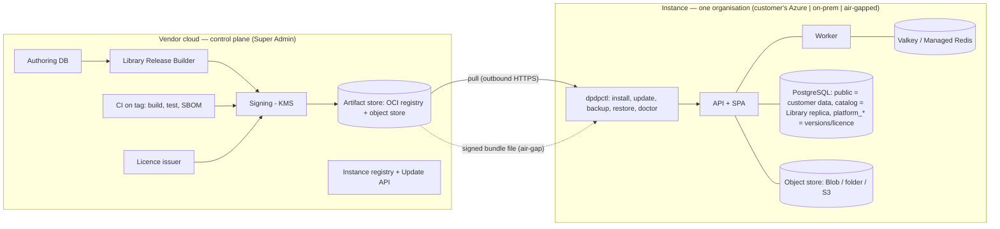

# 01 — Architecture

## 1. System view

Super Admin **never** connects into an instance. Instances never connect to the Super Admin database.

## 2. Variants (one codebase, one set of images)

| Variant | Runs on | Updates | Operator |
|---|---|---|---|
| A. Customer's Azure | Container Apps, PG Flexible Server, Blob, Key Vault | pull | customer |
| B. On-prem + internet for patches | Linux VM, Docker/Podman Compose (Helm optional) | pull | customer (we assist at first) |
| C. On-prem air-gapped | same as B | signed `.bundle` file | customer |

Differences are **configuration, adapters and packaging only** — never `if (mode)` branches in business code.

## 3. Release and update flow

**Publish (Super Admin):** author → cut an immutable **Library Release** (validate closure, hashes, tombstones) → CI builds **App Release** (images + migrations + manifest) → sign with KMS key → push to artifact store → promote through channels `canary → stable → lts`; releases can be flagged `required`, `deprecated`, `recalled`. Instances see only **signed update metadata with a version and an expiry** (anti-rollback / anti-freeze).

**Apply (instance, `dpdpctl`):** verify signature + checksums → stage → **preflight** (versions, disk, drift fingerprint, licence `updatesUntil`) → **backup gate** → migrate (advisory lock) → switch (new revision/containers) → postflight (dangling-reference count = 0, health) → record in `platform_*`. Rollback = previous image (N-1 schema compatibility); DB restore only for destructive/data-step failures.

**Air-gap:** SA builds a signed `UpdateBundle` (changed images, migrations, Library delta, asset packs, refreshed licence) for `from → to`; carried in; `dpdpctl bundle verify | plan | apply`; an `update-report.json` can be carried back. Cumulative bundles inside the support window.

**Patch classes:** P0 Library content (in-app importer, no restart) · P1 licence/config · P2 app only · P3 app + additive schema · P4 contract (destructive; scheduled "required stop" only).

## 4. Versioning and support
- **App:** SemVer (patch = no schema change or additive-compatible; minor = additive; major/stop = contract steps). Images pinned by digest.
- **Schema:** each Prisma history has a `0_baseline` for fresh installs; replay-from-empty + drift check runs in CI.
- **Library:** `YYYY.MM.N` + integer `contentFormat`; importer ignores unknown fields (forward-compatible).
- **Support:** Phase 1 N and N-1 minors; then **annual LTS supported 24 months**, direct upgrade LTS→LTS, every LTS / `required` release is a stop; non-LTS followers may jump from N-3. Security fixes to both LTS lines + latest minor.

## 5. Database and migrations
- Three areas per instance DB: `public` (customer data — **precious**), `catalog` (Library replica — **disposable**, rebuilt from bundles), `platform_*` (installation, licence, release/patch history, trust keys).
- Rules: forward-only SQL; add = expand (nullable / constant default); rename/type change = add new → backfill → switch → drop later; **drop only at a required stop after ≥2 releases of deprecation**; tenant-data tables are archived/renamed before any drop; data backfills are versioned idempotent steps in the same runner; enum additions are additive.
- Customer-added objects are tolerated; **conflicts block the update** with a drift report (changed/dropped managed object; customer `NOT NULL` column without default on a managed table).
- Verified 2026-10-05: tenant (15) and super-admin (19) histories replay from an empty DB with zero drift.

## 6. Data Library (everything Super Admin defines)
Packs: `core` (families, products, master controls, designations, asset catalog), `reg:<code>` per regulation (nodes, applicability, controls, actions, links), `cloud` (providers, asset templates, check mappings), `lms:<set>` (+ asset packs). Entities keep UUIDs and a `contentHash`; retired items ship as tombstones (`retiredAt`, `replacedBy`); the importer **never hard-deletes** anything a tenant row could reference. Licence entitlements filter packs; cross-regulation citations of unlicensed regulations ship as **reference stubs** (id, code, title). Only `PUBLISHED`/`ACTIVE` items ship. The contract uses the **node hierarchy only** — deprecated chapter/section tables never ship.

## 7. Overlays (customer customisation)
`ADD` (custom controls/products) · `EXTEND` (extra actions/citations/links on platform items) · `TUNE` (whitelisted: due days, priority, defaults) · `HIDE` (never mandatory nodes) · `ANNOTATE`. Stored in the tenant schema with `baseRelease` + `baseHash`; one **catalog read service** returns platform ⊕ overlay with provenance. On import, a changed base field that is also overridden goes to a **review queue** (keep / accept / merge); a retired base item stays visible as "retired, replaced by X". DBA edits to `catalog` are unsupported (overwritten; flagged by drift check).

## 8. Licensing
Signed licence (Ed25519 JWS): tenant id, optional instance binding, plan limits, entitlements (packs, features), `validUntil`, `updatesUntil`. Verified offline. States: **active → grace (30 d; 60 d air-gapped) → restricted**, plus **unlicensed**. Restricted (a licence that lapsed, was withdrawn, can no longer be verified, or whose clock was set back) = nothing can be created or changed, **but everyone can still sign in, view everything and export**; renewal works. **Unlicensed** (no licence has ever been installed) = hard gate: only signing in/out and installing the licence work, export included - such an organization has nothing at stake. No transition period in code: an existing customer's licence is issued first and delivered with the upgrade (`LICENCE_TOKEN`); the updater refuses to update an instance with no licence. Online: heartbeat may carry revocation; air-gapped: expiry only, with a monotonic last-seen timestamp against clock rollback. Heartbeat payload: instance id, versions, health, licence state, aggregate active-user count — never customer data.

## 9. Storage and assets
Adapter interface `put/get/delete/exists`; providers Azure Blob (managed identity), local/NAS, S3-compatible. Keys `tenantId/area/parentId/uuid.ext`; customer file names live in the DB. Uploads: allow-list by extension **and** magic bytes, streamed to temp, hashed (SHA-256), then stored; opened only through `POST /files/*/link` → 60 s token → `GET /files/dl/:token` (re-authorised, audited `EVIDENCE_VIEWED`, `nosniff`, sandbox CSP, attachment unless image/PDF). Evidence replace/delete keeps versions; no auto-purge. **Asset Library:** LMS media, sample evidence, logos and certificate images are content-addressed (`asset://<sha256>`), shipped as chunked resumable packs, delivered by hash delta; a course is published only when all its assets are present (importer rule, no LMS UI change). Embedded YouTube/Vimeo lessons cannot play offline and are flagged for air-gap packages. Learner submissions are tenant data.

## 10. Identity, email, auditors
Local passwords always (break-glass admin). **Entra** for Azure customers; **generic OIDC** (discovery URL, group→role claims, JIT provisioning) for AD FS/Keycloak/Okta; LDAP bind fallback. Password reset: hashed single-use 1-hour tokens; reset ends older sessions. Email: SMTP host/port/TLS with optional auth; if no mail server, admins get a copy-link. External auditors: access end date (auto-deactivate), read-only, scoped; Evidence & Audit Trail export (ZIP + hash manifest) for sites they cannot log into.

## 11. Azure reference stack (variant A)
Bicep + Azure Verified Modules; `what-if` before every deploy. Container Apps environment (VNet-integrated): `api` app, `worker` app (KEDA queue scaling), migration **Job**; revisions give zero-downtime + rollback. PostgreSQL Flexible Server (zone-redundant HA in production sizes, PITR 7–35 d, private access). Blob (ZRS/GRS, soft delete, private endpoint, managed identity). Key Vault + managed identities (no secrets in settings). Azure Monitor/Log Analytics. Queue: Azure Managed Redis (**spike: `noeviction`, cluster policy**) else Valkey container. Entra SSO. Sizes map to Container Apps CPU/mem and PG SKUs.

## 12. On-prem reference (variants B/C)
Linux VM (RHEL/Ubuntu LTS), Docker Engine or Podman, rootless-capable images (non-root, read-only rootfs). Compose services: `api`, `worker`, `postgres` (or customer-managed), `valkey`, reverse proxy with customer TLS. File store: volume/NAS (S3 optional). `dpdpctl` installs, updates, backs up, restores, diagnoses, exports a support bundle. Internal DNS + CA certs, NTP, internal SMTP relay or copy-link.

## 13. Configuration contract
Every setting is validated at boot (fail fast, clear message); secrets via env/`*_FILE`/Key Vault references; no tenant-plane setting points at the Super Admin database. Per-deployment settings: database URL, storage (provider + account/container or path), queue URL, JWT secret, encryption keys (**backed up separately**), public app URL, SMTP, IdP, licence file, update source + trust keys. Removed from the tenant plane: `SUPER_ADMIN_DATABASE_URL`, `SUPER_ADMIN_API_URL`.

## 14. Security model
Tenant isolation by deployment (not by row). Role guards by module group; per-task/file rules next to enforcement. Suspended/expired orgs stopped on every request and refresh. Rate limits per user (login/reset per IP+email). Files never public. Signed releases/licences; trust-store with key ids (rotation); metadata expiry; SBOM + image scan in CI. Audit log readable by CEO/CO/Internal Auditor.

## 15. Repository layout
`apps/` (tenant, tenant-api, super-admin, admin-api) · `packages/` (database, storage, shared, ui) · `services/` (cloud-scanner) · `deploy/` (docker, compose, azure/bicep, helm, airgap) · `tools/dpdpctl` · `docs/`. One image set built once; per-customer values/secrets in a separate ops repo or secret manager.
